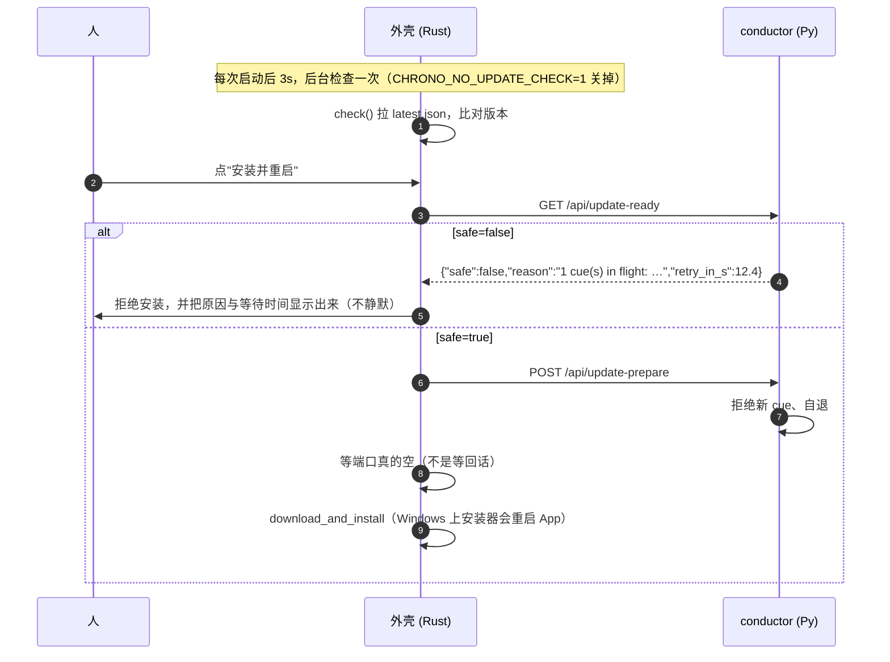

# 自动更新

一个安装包 = **一对**：`chrono-handoff.exe`（外壳）+ `chrono-core.exe`（冻结的 conductor）。
两者必须来自同一次构建，所以更新的单位是**安装包**，而不是任何一个 exe。侧车永远不会单独更新
（那就变成两个版本号、两条回退路径，换不来任何东西）。

## 一、这个组件为什么不能只顾着"装上就行"

| 事实 | 对更新的约束 |
|---|---|
| cue 是**给一个人的、带截止时刻的承诺** | 绝不能在有 cue 处于 `pending/running` 时重启。反之，重启会把人留在一个死掉的窗口前 |
| conductor 是独立进程，占着 8790/8791；Windows 上跑着的 exe 换不掉 | 必须先让它**自己退出**（journal 要落盘、端口要释放） |
| 装在 `%LOCALAPPDATA%`（免管理员，实测） | 更新不需要 UAC。若当初选了 per-machine，自动更新每次都要 UAC，等于没有 |
| 装到自定义目录（如 `B:\software\chrono-handoff`）也能就地更新（实测） | NSIS 记住上次装在哪并装回原处，所以更新器不按固定路径找；外壳据此判断"这份会不会被替换"时看的是 exe 旁边的 `uninstall.exe`，不是安装位置 |
| 状态全在 `~/.chrono-handoff` | 更新碰不到用户状态——这是能做安全更新的前提 |

## 二、分工



- **检查与下载是自动的，安装要人按一下。** 一个测量工具在会话中途被悄悄换代，会让"这周和上周的
  偏移"变得无法归因。
- **"现在能不能停"由 conductor 回答**（见 `component.md` §四点七）：`update_ready` / `stand_down`。
  外壳在安装前先问、再请它走、然后**测量**它是否真的走了。
- 页面通过 **seam 的三个操作**（`update_status` / `update_check` / `update_install`）报告与请求，
  自己不下载任何东西。pywebview 宿主没有更新器，会诚实答 `phase: unsupported`。

## 三、密钥与产物

签名校验是 Tauri 强制的、**不能关**：这个程序能往串口写字节，更新载荷就是远程代码。

```bash
# 私钥永远不进仓库（也不进 CI secret：runner 被攻破一次就能给所有用户推代码）
npx tauri signer generate -w <仓库外的路径>/chrono-handoff.key

# 公钥是公开的，粘进 tauri.conf.json 的 plugins.updater.pubkey（那两行）
```

公钥放 `tauri.conf.json` 而不是环境变量，有两个原因：配置文件是在**构建时**读进去、编译进二进制的
（运行时可改的值就不叫签名了），而且多行的值在环境变量里很难传对（Windows 上尤其）。

没填公钥时构建**照常成功**，但更新功能处于 `unconfigured`——面板会这么说，`update_status`
也能读到，而不是给你一个看起来能用的按钮。

配置里三个已经定好的开关：

| 键 | 值 | 为什么 |
|---|---|---|
| `requireSignedVersion` | `true` | 清单本身**没有签名**，只走 TLS。谁能喂一个伪造响应，就能把虚高的版本号配上更早版本的 url + 签名，逼你降级到一个真实但过时的构建。开了它，签名里带的版本必须和清单一致 |
| `windows.installMode` | `passive` | 有进度条、不需交互；`quiet` 没有反馈，窗口工具突然消失会让人以为崩了 |
| `endpoints` | GitHub `releases/latest/download/latest.json` | 零服务器。Tauri 自己会替换 `{{target}}`/`{{arch}}` |

产物（`createUpdaterArtifacts` **没有**在 `tauri.conf.json` 里打开，因为默认路径要能在没有私钥时
照常出普通安装包）：

```bash
# 发版时：CI（或本地）出安装包之后，带密钥重打一次以生成 .sig 与 updater 产物
cargo tauri build --config '{"bundle":{"createUpdaterArtifacts":true}}'
```

不过实际发版不要手打上面那些步骤，用 `scripts/release.py`：它把安装包拷到暂存目录、
写 `latest.json`，然后**先验签再发布**。

```bash
python scripts/release.py --notes notes.md            # 过闸门 + 暂存 + 验证，打印发布命令
python scripts/release.py --notes notes.md --publish  # 连发布一起做，并回拉端点逐字节比对
python scripts/release.py --selftest                  # 只校准闸门（不需要密钥、不联网）
```

它按顺序卡这几道，任一道不过就不给发布命令：

| 闸门 | 不过时的含义 |
|---|---|
| 工作区干净 | 安装包不对应任何提交 |
| HEAD 的 CI 是绿的 | 发布的东西没人验过（`--wait-ci 900` 可以等） |
| `build.py --stale-check` + `--no-build` | 冻结的 conductor 不是这一版，或四处版本号不一致 |
| 结构闸门 | 清单版本 ≠ 签名版本、url 指向别的文件/tag/仓库、少了 platform 条目、公钥或签名被存成解码后的文本 |
| **真验签** | `scripts/updater_sig_check` 用 `minisign-verify 0.3`（`tauri-plugin-updater` 用的同一个 crate）拿**编译进二进制的公钥**验安装包字节 |

最后一道是关键：换一份 minisign 实现去验，只能证明两份实现互相认同；同一个 crate、同一把公钥，
验的就是应用接下来会做的事。

`latest.json` 挂在 GitHub release 上（`releases/latest/download/latest.json`），字段是
`version` / `notes` / `pub_date` / `platforms.<os>-<arch>.{url,signature}`。
**Tauri 会在比对版本之前校验整份文件**，所以不要放半截的平台条目。

带真密钥跑通后确认的三件事（2026-10-17）：

| 事实 | 含义 |
|---|---|
| `createUpdaterArtifacts` 只出 `.sig`（`bundle/nsis/*.exe.sig`、`bundle/msi/*.msi.sig`） | **`latest.json` 要手写**，Tauri 不生成 |
| `.sig` 是双层 base64：文件内容（外层）就是 `signature` 字段要填的东西 | 直接读文件、原样填，别去解它 |
| 签名内部的 trusted comment 带 `timestamp` / `file` / **`version`** | 这就是 `requireSignedVersion` 的判据：清单里的版本必须与签名里的一致 |

两个已经踩过的坑：

* **`plugins.updater.pubkey` 必须是 `.key.pub` 文件的原文（base64）**，不是它解出来的两行 minisign 文本。存成解码后的形式，每次发版构建都会死在签名那步：`failed to decode pubkey ... Invalid symbol 32, offset 9`（那个 32 就是 `untrusted comment` 里的空格）。`desktop/sidecar/build.py` 现在会离线拦住它——CI 只跑 `cargo build`，不跑 `tauri build`，否则只能等发版时才发现。
* **私钥密码从文件读时要掐掉 CRLF**（`tr -d '\r\n'`）：尾部的 `\r` 会混进密码，症状是“密码明明对却验签失败”。

四条要记住的行为：

| 情况 | 结果 |
|---|---|
| 版本不比当前新 | 不更新（Tauri 默认；`allow_downgrades` 保持 false） |
| 离线 / 端点不可达 | 只记一行日志 + 面板里一句"更新失败"，**不弹框**（气隙网络是文档里的使用场景） |
| 更新到一半失败 | 状态回到 `error`，安装包没换；conductor 已在 `stand_down` 里退出，下次启动会重新拉起 |
| 有 cue 在进行 | 409 拒绝准备，外壳拒绝安装，并显示原因与等待时间 |

## 四、回退：能做的部分，以及它做不到的

**已实现**（三件东西，都在 `~/.chrono-handoff/` 里）：

| 东西 | 作用 |
|---|---|
| `updates/<文件名>` | 更新器**下载下来的那个安装包**（验签之后）会在安装前被留下来 |
| `pending_update.json` | 安装前写入，**App 真的起来了**才删除（窗口建好 + conductor 报的 contract 能对上） |
| `chrono doctor` 的一行 + 一条 problem | 下一步启动时它还在这儿 → 上一次更新没能启动，并把回退路径写出来 |

为什么标记是“写入然后删除”这种形状：**一个起不来的构建无法自己报告它起不来**。所以证据只能是“这个文件**还在**”。App 完全起不来时同理：`report_fatal`（写 conductor.log + 弹 MessageBox）会把版本对、留住的安装包路径、以及 releases 页面一并写进弹框——因为那是唯一还能被人看到的界面。

**它做不到的，说清楚**：留住的安装包是**新版本**的，不是旧版本的。所以它能救的是“装到一半”“新版本自己有点毛病”，
**不能**一键回到上一个版本——那需要旧版本的安装包，而更新器从来没有下载过它。回退到旧版 = 从 releases
页面手动装一次（弹框和 `doctor` 都把这个地址写出来了）。这个限制是真的，没有绕过去：

- 按约定拼旧版本的下载 URL 能拿到它，但那是把“我们自己控制不了的命名规则”当成 API；
- 提前把当前版本的安装包备份一份也不行——App 根本不知道当初是哪个文件装的它。

## 五、还没做（明确写出，免得被当成已实现）

- **装完自检**：更新后第一次启动、conductor 空闲时跑一次 `chrono-core selftest`，失败就建议回退。
- **后台预下载**：现在下载发生在“安装”那一步，会有一段可见的等待（有进度百分比）。
- **beta 渠道**：先只有 stable。
- **更新器只在安装形态下生效**：`CHRONO_PYTHON` / `CHRONO_SIDECAR` 那种源码检出形态下本应直接禁用，
  现在靠“没编公钥就不工作”间接实现，不是一回事。
