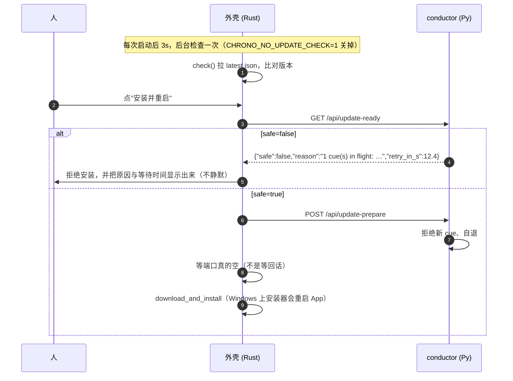

# 自动更新

一个安装包 = **一对**：`chrono-handoff.exe`（外壳）+ `chrono-core.exe`（冻结的 conductor）。
两者必须来自同一次构建，所以更新的单位是**安装包**，而不是任何一个 exe。侧车永远不会单独更新
（那就变成两个版本号、两条回退路径，换不来任何东西）。

## 一、这个组件为什么不能只顾着"装上就行"

| 事实 | 对更新的约束 |
|---|---|
| cue 是**给一个人的、带截止时刻的承诺** | 绝不能在有 cue 处于 `pending/running` 时重启。反之，重启会把人留在一个死掉的窗口前 |
| conductor 是独立进程，占着 8790/8791；Windows 上跑着的 exe 换不掉 | 必须先让它**自己退出**（journal 要落盘、端口要释放） |
| 装在 `%LOCALAPPDATA%`（免管理员，实测） | 更新不需要 UAC。若当初选了 per-machine，自动更新每次都要 UAC，等于没有 |
| 状态全在 `~/.chrono-handoff` | 更新碰不到用户状态——这是能做安全更新的前提 |

## 二、分工



- **检查与下载是自动的，安装要人按一下。** 一个测量工具在会话中途被悄悄换代，会让"这周和上周的
  偏移"变得无法归因。
- **"现在能不能停"由 conductor 回答**（见 `component.md` §四点七）：`update_ready` / `stand_down`。
  外壳在安装前先问、再请它走、然后**测量**它是否真的走了。
- 页面通过 **seam 的三个操作**（`update_status` / `update_check` / `update_install`）报告与请求，
  自己不下载任何东西。pywebview 宿主没有更新器，会诚实答 `phase: unsupported`。

## 三、密钥与产物

签名校验是 Tauri 强制的、**不能关**：这个程序能往串口写字节，更新载荷就是远程代码。

```bash
# 私钥永远不进仓库，也不进 CI secret（这台机器上一次 runner 被攻破就能给所有用户推代码）
cargo tauri signer generate -w <仓库外的路径>/chrono-handoff.key

# 公钥是公开的，编译进二进制：
export CHRONO_UPDATE_PUBKEY="$(cat <仓库外的路径>/chrono-handoff.key.pub)"
```

`CHRONO_UPDATE_PUBKEY` 在**构建时**读进 `lib.rs` 的一个常量。它不能来自配置文件：一个能改配置的东西
就能换掉的"签名"不是签名。没设这个变量时，构建**照常成功**，但更新功能处于 `unconfigured`
——面板会这么说，概况也能从 `update_status` 读到，而不是给你一个看起来能用的按钮。

产物（`createUpdaterArtifacts` **没有**在 `tauri.conf.json` 里打开，因为默认路径要能在没有私钥时
照常出普通安装包）：

```bash
# 发版时：CI（或本地）出安装包之后，带密钥重打一次以生成 .sig 与 updater 产物
cargo tauri build --config '{"bundle":{"createUpdaterArtifacts":true}}'
```

`latest.json` 挂在 GitHub release 上（`releases/latest/download/latest.json`），字段是
`version` / `notes` / `pub_date` / `platforms.<os>-<arch>.{url,signature}`。
**Tauri 会在比对版本之前校验整份文件**，所以不要放半截的平台条目。

四条要记住的行为：

| 情况 | 结果 |
|---|---|
| 版本不比当前新 | 不更新（Tauri 默认；`allow_downgrades` 保持 false） |
| 离线 / 端点不可达 | 只记一行日志 + 面板里一句"更新失败"，**不弹框**（气隙网络是文档里的使用场景） |
| 更新到一半失败 | 状态回到 `error`，安装包没换；conductor 已在 `stand_down` 里退出，下次启动会重新拉起 |
| 有 cue 在进行 | 409 拒绝准备，外壳拒绝安装，并显示原因与等待时间 |

## 四、还没做（明确写出，免得被当成已实现）

- **回退**：Tauri 不提供。计划是留住上一个安装包（`%LOCALAPPDATA%\chrono-handoff\updates\`）+
  `pending_update.json`：装完起不来时下次启动提示回退。
- **装完自检**：更新后第一次启动、conductor 空闲时跑一次 `chrono-core selftest`，失败就建议回退。
- **后台预下载**：现在下载发生在"安装"那一步，会有一段可见的等待（有进度百分比）。
- **beta 渠道**：先只有 stable。
